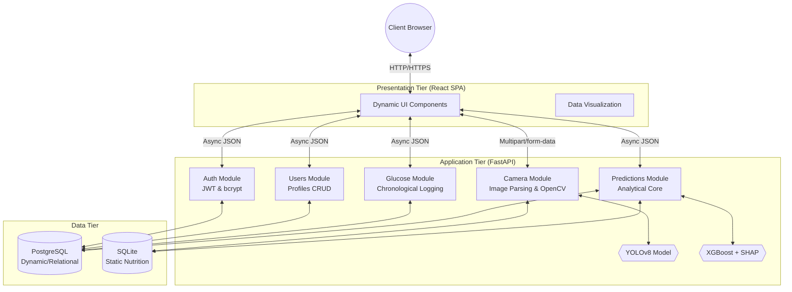
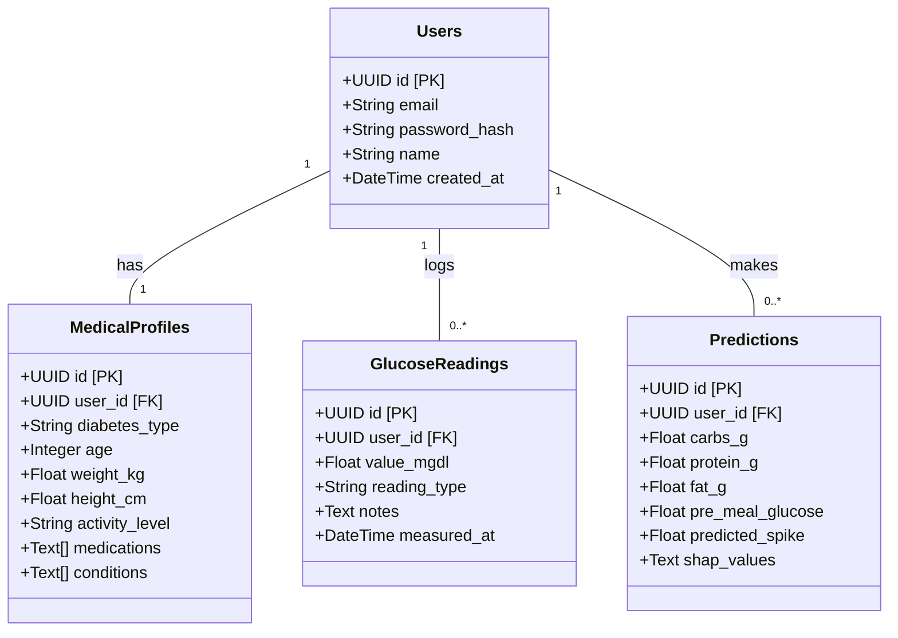
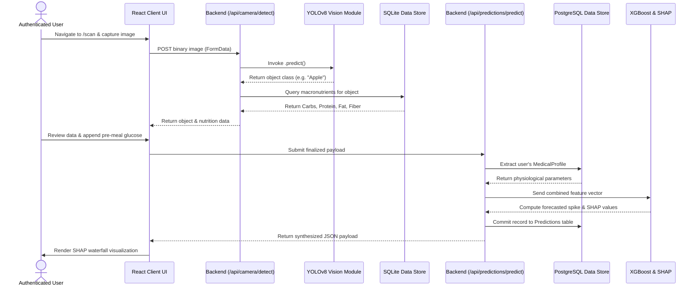
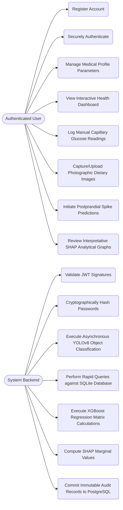
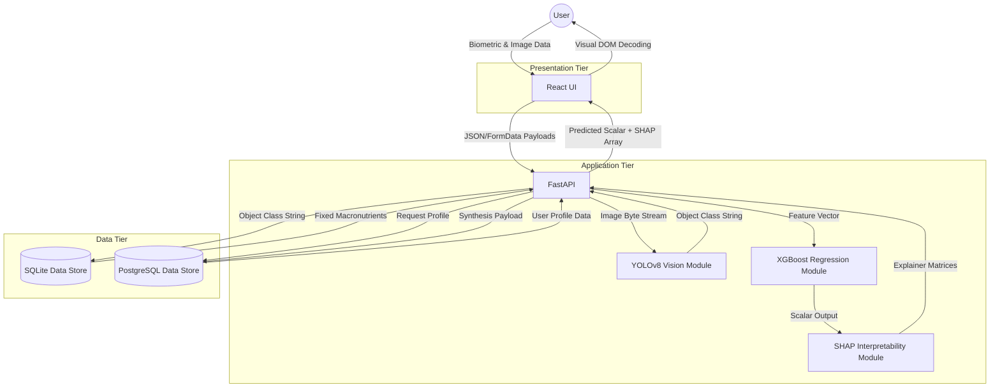

# SmartVision: System Design Diagrams

Below are the Mermaid.js diagrams generated from the Chapter 4 Design specifications. You can copy these directly into your markdown documentation or any Mermaid-compatible viewer.

## 4.1 System Architecture Diagram
Based on sections 4.1.1 and 4.1.2, illustrating the 3-tier architecture and the 5 principal modules.

---

## 4.2.1 Class Diagram
Mapping the core SQLAlchemy ORM declarative base representations.

---

## 4.2.2 Activity Diagram
Illustrating the sequence of actions for the "Scan Food & Predict" workflow.

---

## 4.2.3 Use Case Diagram
Mapping the primary operational actors and their authorized actions.

---

## 4.2.4 Data Flow Diagram (Level 0)
Illustrating the flow of data payloads through the 3-tier architecture.

